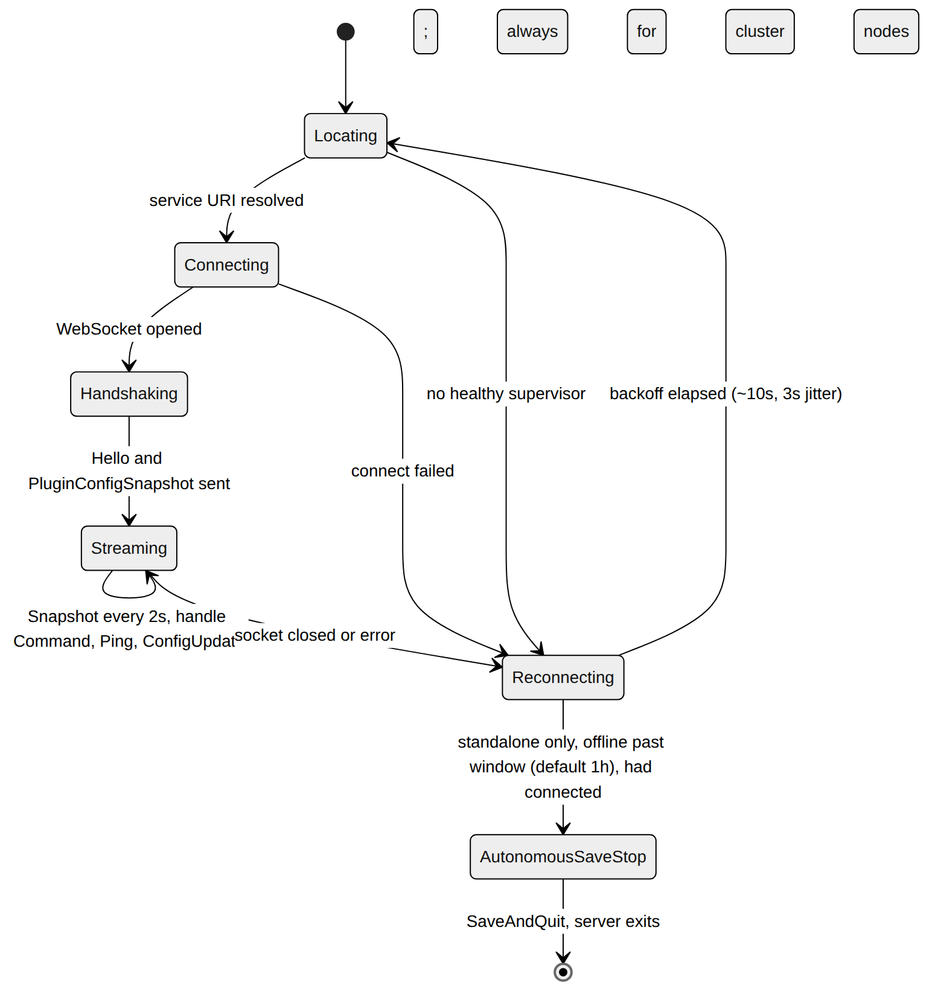
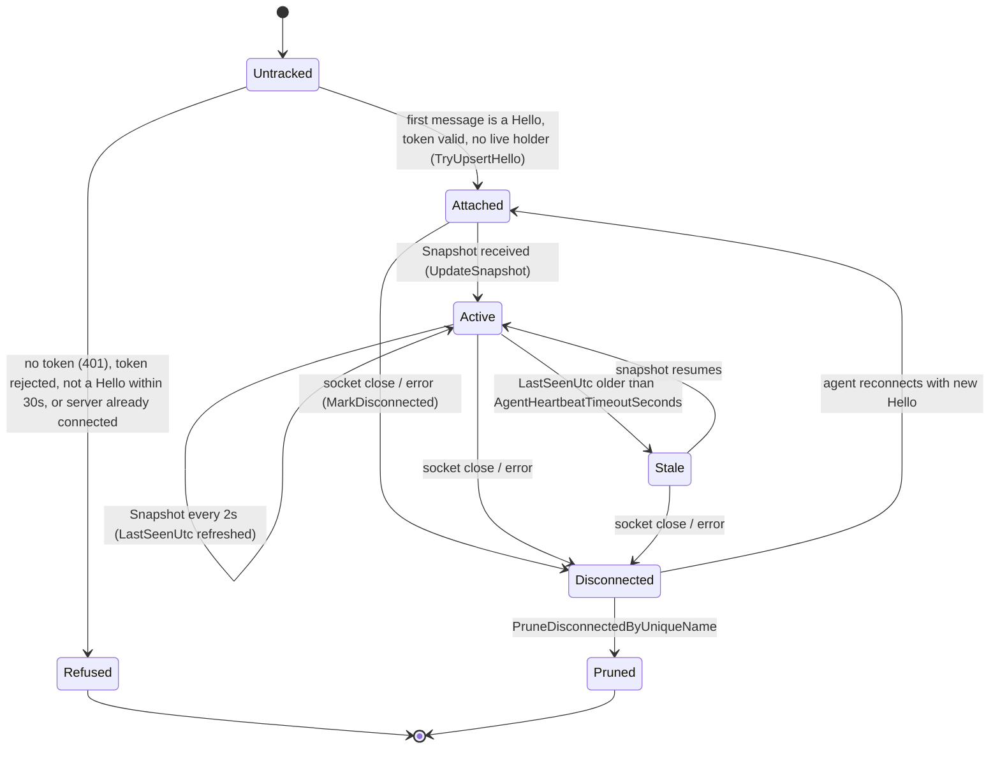
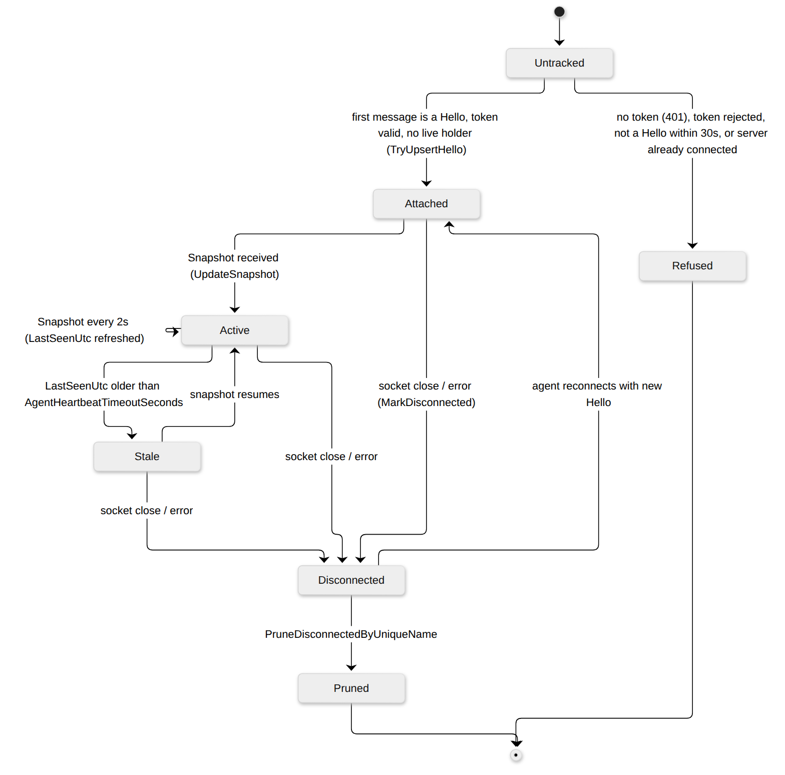

# Agent Connection Lifecycle

`Quasar.Agent` runs inside each Space Engineers dedicated server and attaches to
the Quasar supervisor over a raw WebSocket (`/ws/agent`). There are two
perspectives on one connection: the **agent-side** loop that discovers, connects,
streams, and reconnects, and the **supervisor-side** registry that tracks each
agent as attached/active/stale/dropped.

Relevant source:
[`AgentConnection.cs`](../../Quasar.Agent/AgentConnection.cs),
[`WebServiceLocator.cs`](../../Quasar.Agent/WebServiceLocator.cs),
[`AdminPlugin.cs`](../../Quasar.Agent/AdminPlugin.cs),
[`AgentSocketHandler.cs`](../../Quasar/Services/AgentSocketHandler.cs),
`AgentRegistry`.

---

## Agent side (in-DS)

```mermaid
stateDiagram-v2
    [*] --> Locating
    Locating --> Connecting: service URI resolved
    Locating --> Reconnecting: no healthy supervisor
    Connecting --> Handshaking: WebSocket opened
    Connecting --> Reconnecting: connect failed
    Handshaking --> Streaming: Hello and PluginConfigSnapshot sent
    Streaming --> Streaming: Snapshot every 2s, handle Command, Ping, ConfigUpdate
    Streaming --> Reconnecting: socket closed or error
    Reconnecting --> Locating: backoff elapsed (~10s, 3s jitter); always for cluster nodes
    Reconnecting --> AutonomousSaveStop: standalone only, offline past window (default 1h), had connected
    AutonomousSaveStop --> [*]: SaveAndQuit, server exits
```

| State | Behavior |
| --- | --- |
| `Locating` | `WebServiceLocator` probes the explicit supervisor URL from `QUASAR_BASE_URL` (plus compatible public-base-url variables) and the discovery manifest, accepting the first `/api/health` response that succeeds. If no healthy instance is found, the agent does not start Quasar or Bootstrap; it waits for the reconnect loop. |
| `Connecting` | Opens `ws(s)://…/ws/agent` (WebSocket keep-alive 20s) with the `QUASAR_AGENT_TOKEN` value in the `X-Quasar-Agent-Token` header. Quasar answers 401 without the header, or 403 when socket source, Host or Origin policy fails. See [machine endpoint policy and upgrade order](../SecurityUpgradeDIS0042.md). |
| `Handshaking` | Sends the `Hello` identity message and forces an initial `PluginConfigSnapshot`. Cluster hello/snapshot payloads include cluster, node, and role tags from the executor environment. |
| `Streaming` | Sends a `Snapshot` every ~2s, flushes buffered plugin-log batches, and dispatches inbound `Command` (including `PluginRequest` companion dispatch) / `Ping` / `PluginConfigUpdate` messages. A cluster node that owns no partitions (a hot spare, or a node still starting) marks its snapshot `TelemetryPaused`: it leaves out profiler and plugin stats, and Quasar records no analytics for it. The World Authority is never paused. Telemetry resumes with the next snapshot after the node gets a partition. |
| `Reconnecting` | On socket error/close, waits `ReconnectIntervalSeconds` (~10s) ± jitter (~3s) then re-locates. |
| `AutonomousSaveStop` | Standalone only: if the agent had connected at least once and Quasar stays unreachable past `OfflineShutdownSeconds` (default 3600s), it performs a `SaveAndQuit`. The "had connected" guard prevents auto-stopping a server that never attached. |

Cluster mode is active when `CLUSTER_GATEWAY_REGISTRY` is set, matching
ClusterRuntime's own activation rule. In this mode the agent reconnects indefinitely,
does not register its standalone `!stop`, `!restart`, or `!quit` commands, and rejects
save/stop commands arriving through the agent channel. Magnetar's cluster-aware commands
route lifecycle intent through PluginSdk to the Gateway instead.

On standalone servers, an admin-initiated in-game shutdown (not a Quasar-requested stop) sends an
`AdminStop` wire message before exit so the supervisor flips the goal to `Off`
(see [Dedicated Server Lifecycle](DedicatedServerLifecycle.md#goal-state)).

---

## Supervisor side (registry view)

| State | Meaning |
| --- | --- |
| `Untracked` | No connection registered yet. |
| `Refused` | Closed with policy violation and never registered. `AgentSocketAuthenticator` checks the token against the Hello: a standalone token is an HMAC of the unique name under Quasar's key, a cluster token an HMAC under the enrollment credential of the Host named by `HostId`. A connection is also refused while another connection for the same `AgentId`, or the same standalone unique name, was seen in the last 30 s; a quieter holder is dropped as a dead socket. |
| `Attached` | `Hello` registered the agent (`IsConnected = true`, sender callback cached). |
| `Active` | Snapshots are flowing; `LastSeenUtc` is fresh. |
| `Stale` | `LastSeenUtc` older than `AgentHeartbeatTimeoutSeconds` — health monitoring marks the server `Unhealthy`, but the socket may still be open. |
| `Disconnected` | Socket closed/error; `MarkDisconnected` clears the sender and fails pending command awaiters. |
| `Pruned` | Removed from the registry (server definition removed / GC). |

The supervisor never reconnects the agent itself — reconnection is entirely
agent-driven. The registry only observes liveness (`LastSeenUtc`) and dispatches
commands via the cached sender, awaiting correlated `CommandResult` replies.
The agent never starts the Quasar supervisor, Bootstrap launcher, or UI; those
remain operator/service-owned processes.

---

## Related

- [Dedicated Server Lifecycle](DedicatedServerLifecycle.md) — health uses the heartbeat tracked here.
- [Architecture › Transport Model](../QuasarArchitecture.md#transport-model)
- Back to the [State Machine Index](Index.md).
