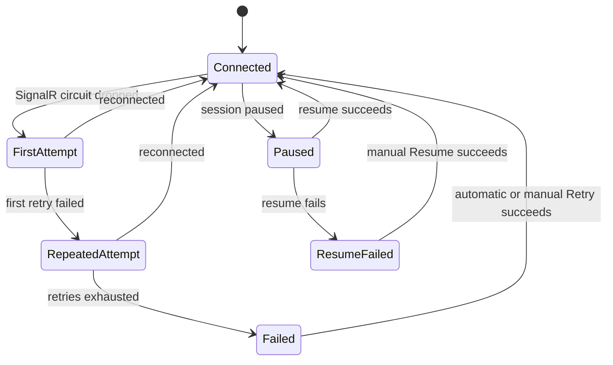
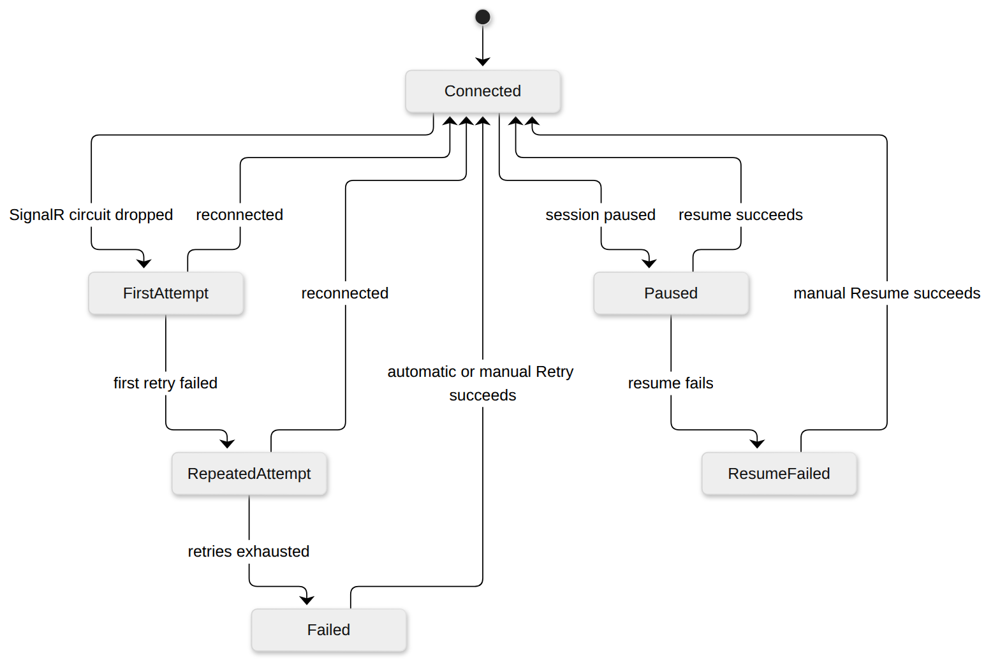

# Blazor Circuit Reconnection

The Quasar UI is a Blazor Server app, so the browser holds a SignalR circuit to
the worker. When that circuit drops — including during the brief worker cutover
of a [self-update](SelfUpdateAndRelease.md) — the framework's reconnection UI
takes over. Quasar styles this through
[`ReconnectModal.razor`](../../Quasar/Components/Layout/ReconnectModal.razor)
and its CSS/JS, but the states themselves are managed by the ASP.NET Core Blazor
circuit handler.

If startup fails before a circuit exists, the browser shows **Quasar connection
unavailable**. A startup that is still pending after ten seconds shows a warning
that live updates and controls are not available yet. This covers session and
module loading failures as well as WebRTC or socket startup. A successful startup
clears the warning. **Reload page** works entirely in the browser, even when
Blazor never becomes interactive.

Startup recovery probes readiness and the protected version endpoint. Once both
succeed, failed startup reloads automatically after five seconds. Consecutive
failures back off to ten, twenty, forty and sixty seconds, retained per panel in
this tab's session storage. Successful hydration clears the backoff. Pending
startup gets sixty seconds before recovery reloads so normal direct and relay
ICE setup can finish. Gateway errors and expired login responses do not trigger
automatic reloads. Reloading starts a fresh document because `Blazor.start` can
only run once per document.

After a circuit disconnects, the reconnect dialog explicitly warns that live
updates and controls are unavailable and displayed data may be out of date.
It retains the framework's retry countdown and offers **Reload page** in every
state, alongside **Retry** or **Resume** when applicable. The same warnings apply
to hosted WebRTC and direct socket connections. Connection loss is reported when
the framework detects it; a silent transport stall still depends on its timeout.

> This is an informational diagram of framework behavior; there is no Quasar
> enum behind it. The CSS classes that gate each visible state are
> `components-reconnect-first-attempt-visible`,
> `components-reconnect-repeated-attempt-visible`,
> `components-reconnect-failed-visible`, `components-pause-visible`, and
> `components-resume-failed-visible`.

| State | Meaning |
| --- | --- |
| `Connected` | Circuit healthy; the modal is hidden. |
| `FirstAttempt` | Circuit dropped; the dialog warns that data may be stale while reconnecting. |
| `RepeatedAttempt` | First retry failed; a countdown is shown. |
| `Failed` | Framework retries exhausted; Quasar retries every five seconds while the authenticated panel is ready. **Retry** remains available. |
| `Paused` | Server session paused; awaiting resume. |
| `ResumeFailed` | Resume failed; a **Resume** button is shown. |

Because a worker cutover replaces the circuit, browsers briefly reconnect after
an update — see the [practical guarantees](../QuasarArchitecture.md#self-update-and-version-rollover)
for self-update.

## Worker replacement recovery

While the circuit is disconnected, Quasar also checks the panel's `api/ready`
and protected `api/version` endpoints once per second. Each probe has a five-second
deadline and uses the current panel base path, including a Nebula prefix.
The page remembers the worker ID it loaded. Once readiness succeeds and the
version endpoint reports a different worker ID, the browser reloads immediately
to establish a new circuit. This also handles a same-version restart and updates
started in another browser, without waiting for the framework's retry timeout.

A transient disconnect to the same worker does not reload the page. Readiness
failures, sign-in redirects and gateway error pages keep recovery pending.
After framework retries exhaust, the same recovery probe also retries the
existing circuit every five seconds. Manual and automatic retries never run
concurrently. A rejected circuit attempts resume, then reloads if it cannot resume.
Framework retry-countdown events keep these probes running, including between
connection attempts; they must not cancel worker replacement detection.
Reconnection, a paused session or the planned-restart progress panel cancels the
independent probes; a late response cannot reload over a recovered session.
Planned restart health and version requests also have five-second deadlines, so
a stalled HTTP request cannot stop the restart watcher from polling again.
Public health/readiness responses remain status-only. Worker identity is included
with the version response, which retains its dashboard-read authorization.

---

## Related

- [Self-Update and Release Cutover](SelfUpdateAndRelease.md)
- Back to the [State Machine Index](Index.md).
