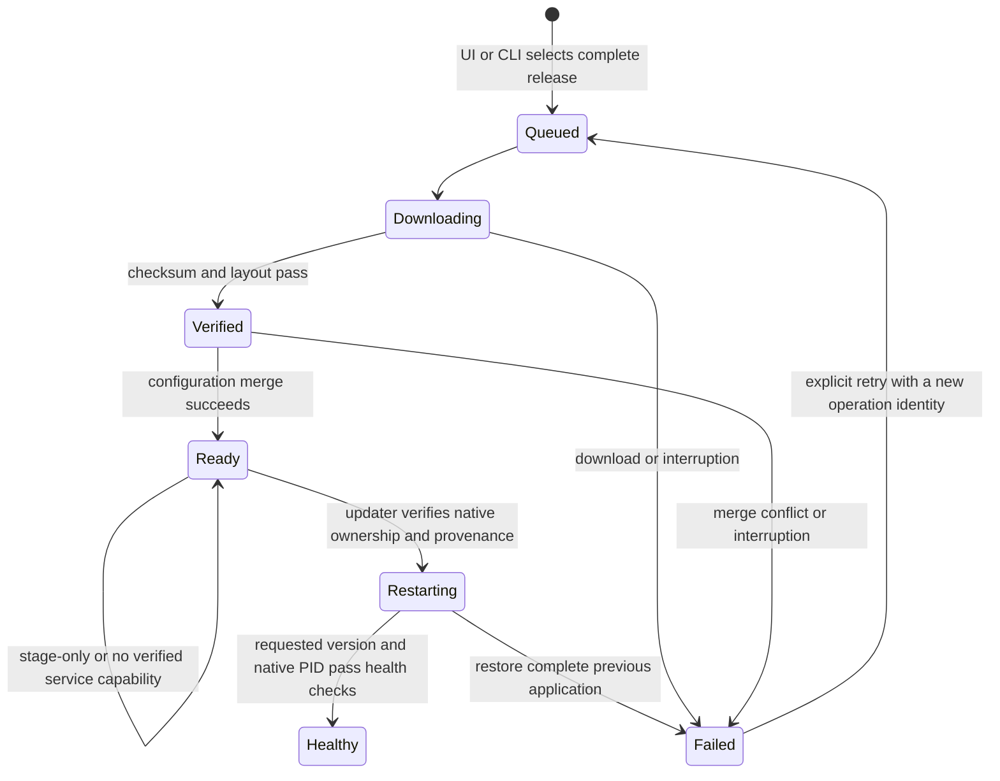

# Self-Update and Release Cutover

The UI and supervisor form one Quasar application. The application owns release
selection, checksum staging and configuration merge. A separate native updater
owns stop, file replacement, restart, health verification and complete rollback.
See [updates and migration](../QuasarUpdates.md).

## Update status (worker side)

`Shared/Updates/QuasarUpdateOperation.cs` persists the operation ID, target and
stage. The historical worker-side snapshot remains a catalog view; it cannot
acknowledge successful activation.

## Bootstrap launcher / worker cutover

Bootstrap is a legacy recovery path. Current packages run Quasar directly under
systemd or Windows SCM. The updater is outside the main process and its Windows
file locks. It never rewrites its own executable during an application update.

The maintenance lease protects state and files, but is released across native
stop/start so main shutdown can persist game-server adoption state. A durable
maintenance marker preserves game servers even if ordinary shutdown is configured
to stop them. Intentional application exit remains a successful stop.

Before replacement, the updater keeps a complete manifest-owned application and
configuration snapshot. `installing`, `attempted`, `committed` and `rolled-back`
transaction phases let the updater recover actual files after process or machine
restart. It checks both the marker/journal and the transaction phase, rather than
relying on a consumed request. Linux syncs directory metadata when publishing
state; Windows publication requests write-through semantics.

## Related

- [Managed runtime provisioning](ManagedRuntimeProvisioning.md)
- [Architecture](../QuasarArchitecture.md#self-update-and-version-rollover)
- [State machine index](Index.md)
