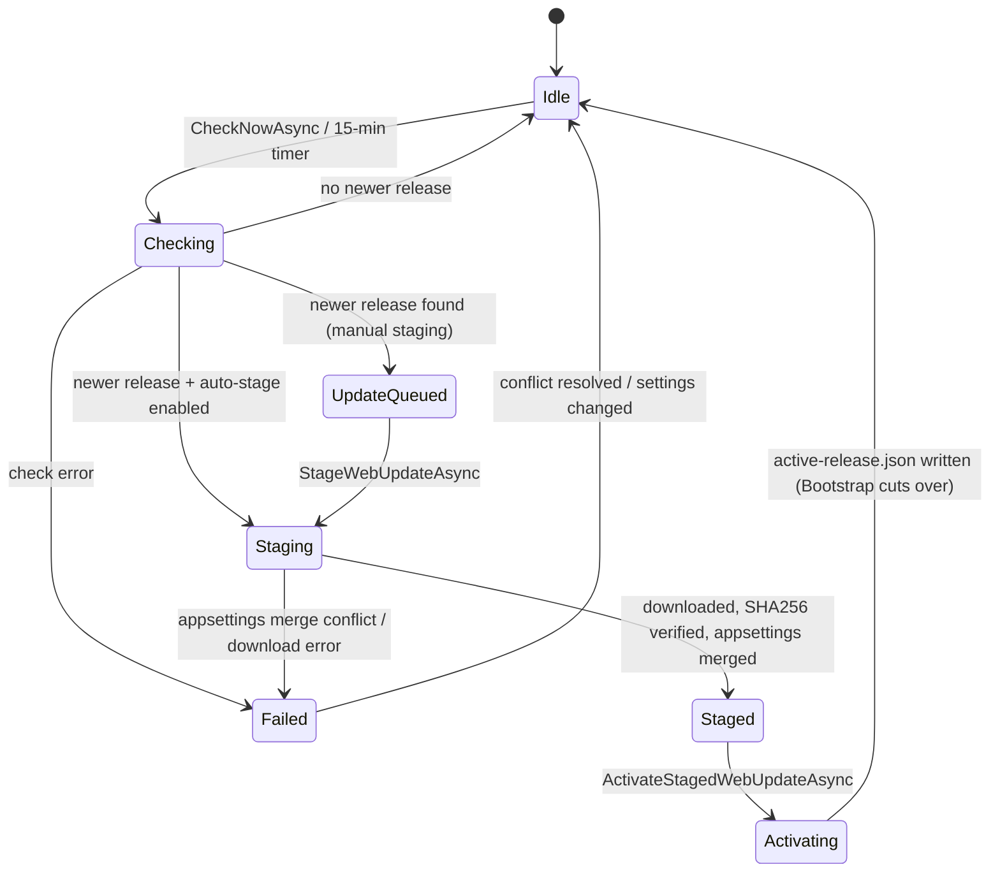
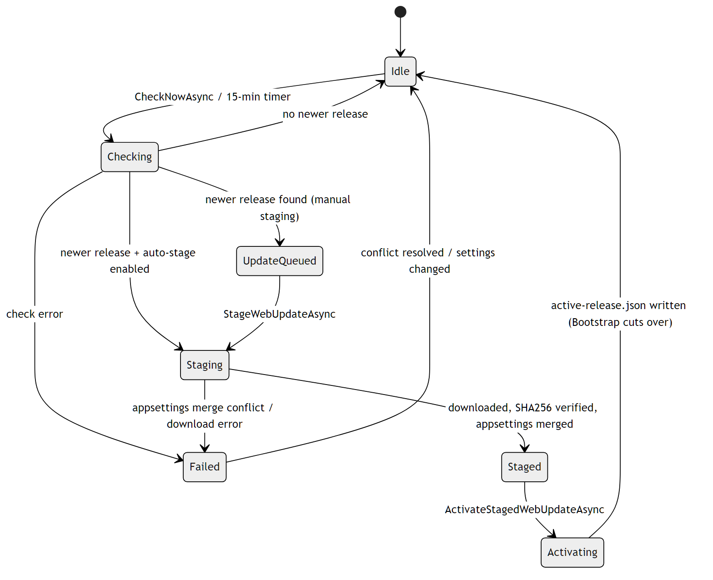
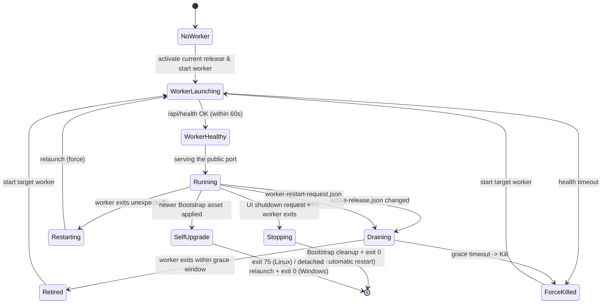
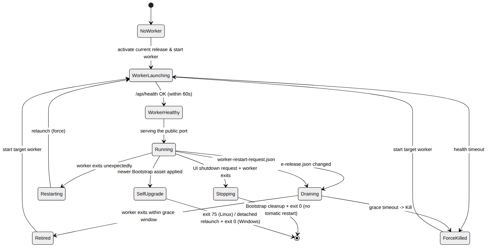

# Self-Update and Release Cutover

Quasar updates itself in two coordinated state machines: the **worker** (the
Blazor supervisor) checks GitHub, stages, and activates a new web release; and
the stable **Bootstrap launcher** observes the activated release pointer and
performs the worker cutover while keeping managed DS processes running.

Relevant source:
[`QuasarUpdateSnapshot.cs`](../../Quasar/Services/Updates/QuasarUpdateSnapshot.cs),
`QuasarUpdateService`,
[`Quasar.Bootstrap/Program.cs`](../../Quasar.Bootstrap/Program.cs) (`LauncherCoordinator`).

See also the deployment guides:
[Linux](../LinuxDeploymentAndUpdates.md) · [Windows](../WindowsDeploymentAndUpdates.md).

---

## Update status (worker side)

[`QuasarUpdateStatus`](../../Quasar/Services/Updates/QuasarUpdateSnapshot.cs)
tracks the staged-update workflow shown on `/settings/updates`.

| State | Meaning |
| --- | --- |
| `Idle` | No update activity. |
| `Checking` | Querying GitHub releases (every 15 min, or on demand). |
| `UpdateQueued` | A newer release exists and awaits an explicit stage (auto-stage off). |
| `Staging` | Downloading the asset, verifying it against `SHA256SUMS`, and performing the three-way `appsettings.json` merge (data-dir base + install values + new defaults). |
| `Staged` | Payload validated and ready to activate. |
| `Activating` | Promoting the staged payload into `ManagedRuntime/WebService/<version>/` and writing `Updates/active-release.json`. |
| `Failed` | A check/download error or an unresolved `appsettings.json` merge conflict; cleared when the conflict is resolved or settings change. |

GitHub release checks and downloads retry transient transport failures, HTTP
`408`, `429`, and `5xx` responses up to four times after the initial request.
Retries use 1, 2, 4, and 8 second delays, honor GitHub's `Retry-After` header,
and cap any delay at 30 seconds. Permanent failures still enter `Failed`; the
running worker remains available for a later check or manual retry.

---

## Bootstrap launcher / worker cutover

The launcher owns the public port (systemd service on Linux, Scheduled Task on
Windows). It watches the active-release pointer and drains/replaces the worker —
a launcher, **not** a reverse proxy — so the public endpoint has only a short
listener gap while managed Magnetar servers keep running detached.

| State | Meaning |
| --- | --- |
| `NoWorker` | Startup before a worker exists; may download an initial UI worker. |
| `WorkerLaunching` | Worker process started; polling `/api/health` (up to 60s). |
| `WorkerHealthy` / `Running` | Worker serving the public port. |
| `Draining` | Pointer change or `Updates/worker-restart-request.json` detected; the launcher posts `/api/internal/drain` (authenticated with the per-session launcher token) and waits for graceful exit. Pointer changes start the new active release; worker-restart requests start the same active release again. |
| `Retired` / `ForceKilled` | Old worker exited within the grace window, or was killed after timeout. |
| `Restarting` | Worker exited unexpectedly (not a launcher request); relaunched with `force`. |
| `Stopping` | UI **Shutdown Quasar** wrote `launcher-shutdown-request` and the worker exited; Bootstrap prevents worker respawn, cleans up its watchers, and exits **0**. The installed service/task restart-on-failure policy leaves it stopped until explicitly started again. |
| `SelfUpgrade` | A newer Bootstrap asset was applied by a consumed `Updates/bootstrap-update-request.json` request from the worker’s automatic update policy or the Updates page; requests target the detected version and platform asset. Linux exits **75** so systemd restarts it; Windows spawns a detached `Quasar.exe serve --quiet` replacement and exits **0**. |

The pointer is `Updates/active-release.json`
([`QuasarActiveReleasePointer`](../../Magnetar.Protocol/Runtime/QuasarActiveReleasePointer.cs)),
written by the worker's `Activating` step and observed via a `FileSystemWatcher`
(debounced ~250ms).

Each worker writes the shared supervisor discovery manifest on startup and only
deletes it on shutdown when the on-disk worker id and process id still match that
same worker. During cutover this prevents the retiring worker from deleting the
new worker's manifest after agents have started reconnecting.

Managed DS processes are not stopped during worker cutover, so their loaded
`Quasar.Agent` assembly can remain older than the newly active web release. On a
later server Restart action, `DedicatedServerSupervisor.RestartServerAsync`
compares the attached agent's hello version with the bundled
`Agent/Quasar.Agent.dll`; a mismatch is handled by the normal full stop/start
path, which runs launch preparation and injects the current agent before the
process starts again.

---

## Related

- [Managed Runtime Provisioning](ManagedRuntimeProvisioning.md) — DS/SteamCMD install before a server can start.
- [Architecture › Self-Update and Version Rollover](../QuasarArchitecture.md#self-update-and-version-rollover)
- Back to the [State Machine Index](Index.md).

Automatic application is opt-in (`Quasar:Updates:AutoApplyUpdates`). It selects
matching UI/Bootstrap assets, stages the UI first, and sends its prepared pointer
in the Bootstrap request. Bootstrap publishes it only after installer verification,
then suppresses pointer-triggered worker replacement during launcher cutover.
A saved previous pointer provides UI rollback if the new worker fails startup
health checks. Stage-only mode and manual activation remain available. See
[automatic update configuration](../Configuration.md#automatic-quasar-and-ui-plugin-updates).

The Bootstrap installer leaves `WebService/` and root `appsettings.json` intact:
UI activation uses the separately staged release pointer. This also preserves the
packaged worker when it is the rollback target. Bootstrap revalidates the prepared
UI directory after download, under the shared maintenance lease, before cutover.

Once a worker passes its startup health check, Bootstrap removes completed
payloads from `Updates/Staged/` under the maintenance lease. UI payloads at or
below the healthy worker version and `Bootstrap-<version>` payloads at or below
the running launcher version are removed. This also clears leftovers on ordinary
startup after a coordinated launcher update. Newer staged releases and any
directory containing the running worker are preserved. Failed worker starts do
not trigger cleanup. Filesystem failures are logged and retried on the next
successful worker start.
