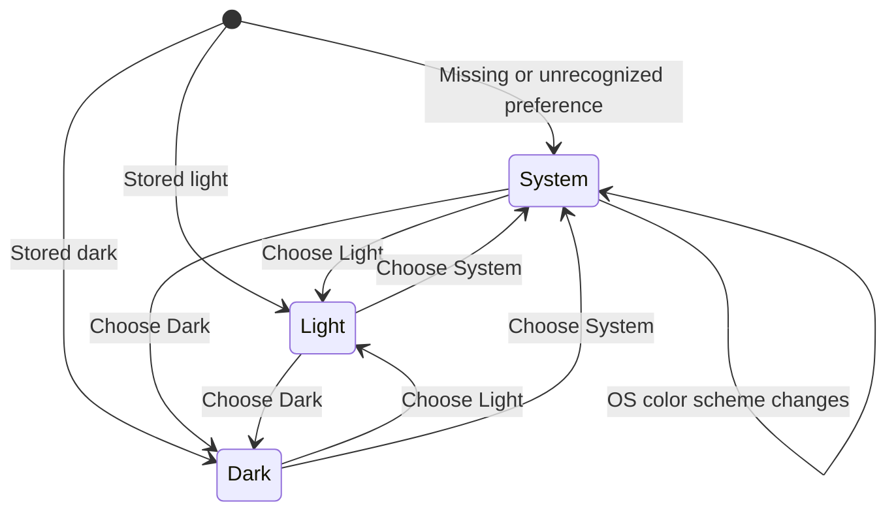
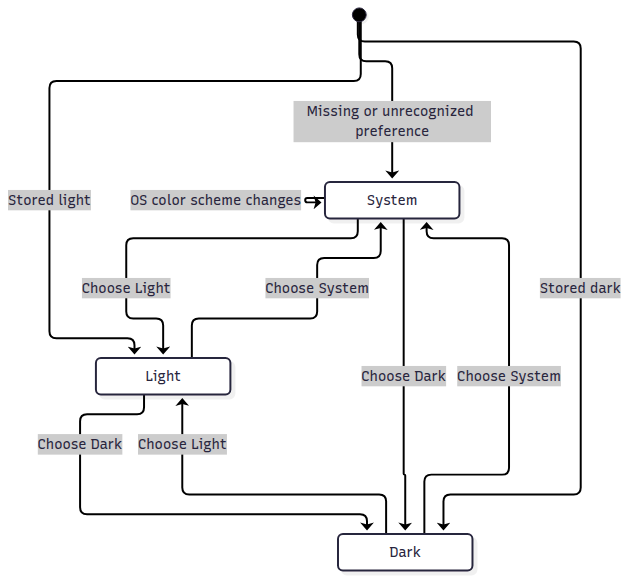

# Theme mode

The browser applies the selected theme as soon as the dashboard shell loads. Each panel stores its own choice under the `quasar.theme.mode` preference. Existing plain-text and JSON-quoted values are supported. [Dashboard shell](../../Quasar/wwwroot/_quasar/sdk/v1/dashboard.js)

| Preference | Palette |
| --- | --- |
| System | Follows the browser’s current `prefers-color-scheme` setting and updates when it changes. |
| Light | Uses the configured light palette and logo. |
| Dark | Uses the configured dark palette and logo. |

An administrator can change the panel’s branded palettes and logos in Appearance. Each viewer keeps their own mode selection. [UI theme](../QuasarArchitecture.md#ui-theme)
